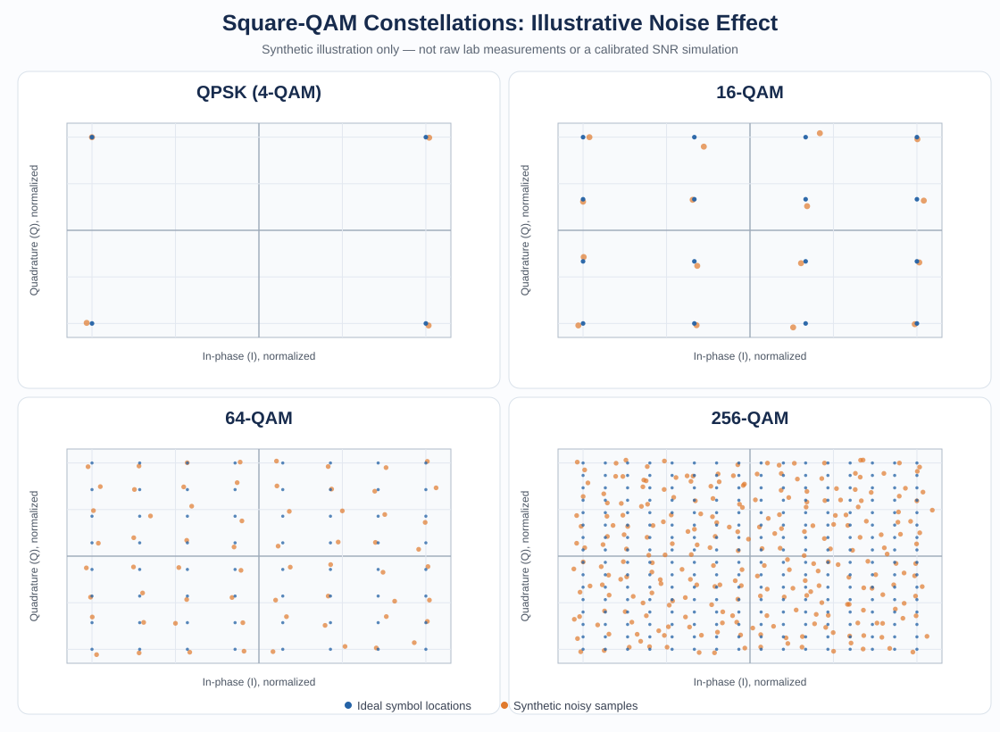

# I/Q Modulation and Wireless Transmission Analysis

<p align="center">
  <b>Hardware-based digital communications experiment</b><br>
  QPSK · 16-QAM · 64-QAM · 256-QAM · Wired vs. Wireless RF
</p>


This project documents a digital communications laboratory experiment investigating how modulation order and wireless propagation conditions affect received signal quality. Signals were generated using a **Rohde & Schwarz SMIQ3B** RF signal generator and examined through constellation and eye diagrams.

> **Main observation from the lab report:** 256-QAM showed noticeable constellation spreading and noise in the antenna-based setup, while QPSK was comparatively robust. Partial antenna obstruction produced distortion and symbol overlap.

## Constellation overview

The graphic below is a **synthetic illustration** showing ideal symbol locations and slightly perturbed samples. It is not a screenshot of the hardware measurement and does not represent a calibrated SNR or measured BER.



## Objectives

- Investigate coherent in-phase/quadrature (I/Q) modulation.
- Observe QPSK, 16-QAM, 64-QAM, and 256-QAM.
- Compare wired and antenna-based wireless transmission.
- Use constellation and eye diagrams to inspect signal quality.
- Observe the effects of antenna alignment and partial obstruction.

## Equipment and setup

| Item | Details |
|---|---|
| RF signal generator | Rohde & Schwarz SMIQ3B |
| RF frequency | 70 MHz, as stated in the lab report |
| Modulation schemes | QPSK, 16-QAM, 64-QAM, 256-QAM |
| Link conditions | Wired and antenna-based wireless |
| Visual analysis | Constellation diagrams and eye diagrams |

The report also describes QPSK trials at 1 kbit/s and 10 kbit/s. Numerical performance datasets such as BER, EVM, and measured SNR were not reported.

## Modulation schemes

| Scheme | Bits per symbol | Practical trade-off |
|---|---:|---|
| QPSK | 2 | More robust symbol separation |
| 16-QAM | 4 | Higher spectral efficiency, greater sensitivity than QPSK |
| 64-QAM | 6 | Denser constellation and tighter decision margins |
| 256-QAM | 8 | Highest spectral efficiency of the tested schemes; more sensitive to signal impairments |

Higher-order QAM packs more symbols into the constellation. As a result, noise and distortion can make correct symbol decisions more difficult.

## Experimental methodology

1. Configure the SMIQ3B for the selected modulation scheme.
2. Generate and inspect QPSK and QAM signals.
3. Examine constellation and eye diagrams in the wired setup.
4. Repeat observations with antenna-based wireless transmission.
5. Observe signal quality under antenna alignment changes and partial obstruction.
6. Compare the qualitative effects of channel conditions across modulation orders.

## Results and observations

### QPSK

The report describes QPSK as comparatively robust, with clear symbol separation and minimal overlap. Its antenna-based eye/constellation view provides a useful baseline.

### 16-QAM

The 16-QAM wired measurements show a denser constellation than QPSK, illustrating the increased symbol density associated with more bits per symbol.

### 64-QAM and 256-QAM

The wired constellation screenshots show the high symbol density of 64-QAM and 256-QAM. In the wireless observations, higher-order schemes were more affected by imperfect transmission conditions.

### Wireless impairment and obstruction

The report records noticeable noise and spreading in the 256-QAM antenna measurement. A partially blocked antenna condition also produced constellation distortion and symbol overlap.

**Overall finding:** The experiment demonstrated the trade-off between spectral efficiency and robustness. QPSK was comparatively tolerant of the tested conditions, while higher-order QAM—especially 256-QAM—showed more visible degradation.

## Reproduce the illustrative simulation

A small Python script provides a separate, repeatable demonstration of how additive noise in normalized I/Q coordinates appears for different square-QAM orders. This is an educational simulation, not a reconstruction or replacement for the hardware experiment.

### Setup

```bash
python -m pip install -r requirements.txt
python analysis/qam_awgn_demo.py
```

By default, the script saves `images/qam-awgn-simulation.png`. You can change the modulation orders, noise level, number of samples, random seed, and output path:

```bash
python analysis/qam_awgn_demo.py --orders 4 16 64 256 --noise-std 0.06 --samples 1500 --seed 7
```

The `--noise-std` value is expressed in normalized constellation-coordinate units. It is **not** a calibrated SNR. No BER, EVM, or RF channel-performance claims are derived from this simulation.

## Tests and automation

The project includes unit tests for the ideal constellation generator and a GitHub Actions workflow that runs the tests on Python 3.10 and 3.12, then smoke-tests the plotting command.

To run the tests locally:

```bash
python -m unittest discover -s analysis -p 'test_*.py'
```

## Limitations

This repository summarizes qualitative observations from the supplied lab report. It does **not** claim quantitative BER, EVM, or SNR results because corresponding measurement data were not established in the report. Keep generated plots clearly labelled as simulations and any future hardware screenshots labelled as measured results.

## Repository structure

```text
iq-modulation-wireless-analysis/
├── README.md
├── images/
│   └── qam-constellation-illustration.svg
├── analysis/
│   ├── qam_awgn_demo.py
│   └── test_qam_awgn_demo.py
├── docs/
│   └── measurement-notes.md
├── .github/
│   └── workflows/
│       └── python-tests.yml
├── requirements.txt
└── .gitignore
```

## Skills demonstrated

- Digital communications and I/Q modulation concepts
- QPSK and QAM modulation trade-offs
- RF signal generation with laboratory equipment
- Constellation and eye-diagram interpretation
- Wired versus wireless link comparison
- Qualitative analysis of antenna alignment and obstruction effects
- Python-based visualization of a clearly separated educational simulation
- Unit tests and automated checks
- Technical documentation of experimental results and limitations

## Academic context

Based on a Digital Communications laboratory experiment on I/Q coherent modulation and wireless transmission at Hamburg University of Applied Sciences (HAW Hamburg), conducted in July 2025.

Please ensure any lab screenshots, photographs, or full report shared publicly comply with course/university rules and do not expose other participants' personal information.
